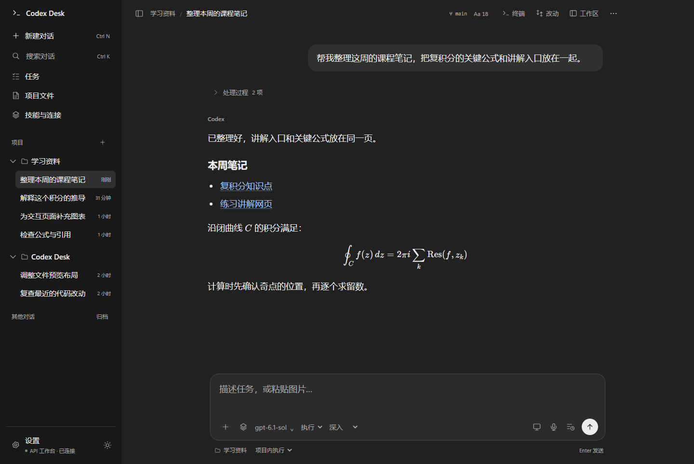

# Codex Desk

Windows / macOS 上的独立 Codex 桌面客户端，使用 Codex app-server 执行本地任务，连接你选择的 OpenAI Responses API 兼容服务。

An independent desktop client for Codex app-server and Responses-compatible API providers.

[MIT](LICENSE) · [使用与开发](#从源码运行) · [安全说明](SECURITY.md)



## 能做什么

- 本地任务：文件读写、命令执行、交互终端、工具审批，项目内与完全访问模式。
- 对话：项目归组、重命名、搜索、置顶、归档、分支、上下文整理，处理过程默认折叠。
- 阅读与输入：Markdown、代码、KaTeX 公式、本地文件链接、预览、粘贴图片，14–28号字体与深浅主题。
- 工作区：Git 差异与分块暂存、提交、分支、工作树、GitHub PR、编辑器检查点。
- 任务管理：计划模式、目标预算、排队、并行对话、本地定时。定时需要应用运行、电脑保持唤醒。
- 扩展：个人 Skills、标准 MCP 服务、独立外部授权、本地浏览器和文档工具。
- 媒体：兼容服务的图像接口；可选本地中文语音识别与系统朗读；可选主屏鼠标、键盘和截图工具。

这是独立社区项目。官方桌面的云任务、托管插件商店、账号额度和云文档服务不在本项目范围内。

## 从源码运行

需要 Git、**Node.js 22.15 或更新版本（包含 npm）**。可选本地工具需要 Python 3.10+。

```sh
git clone https://github.com/Felix-robot/codex-desk.git
cd codex-desk
npm ci
npm run setup
npm start
```

`npm ci` 安装锁定的依赖和公开的 `@openai/codex@0.163.0` 包。`setup` 下载当前系统的 Electron，将执行引擎、Code Mode host 和 rg 整理进忽略提交的 `runtime/`，并在独立数据目录配置本地工具。源码仓库不包含引擎、Electron、Python 或用户凭据。

在左下角打开设置，填写 **API Base URL、API key 和该提供商支持的模型**。默认地址 `https://api.example.com/v1` 是占位符，使用前必须替换。默认模型名称为 `gpt-6.1-sol`；可用性以提供商返回的 `/models` 为准。

API key 通过 Electron `safeStorage` 保存，或只用于当前会话。不要把 key 写进源码、配置示例或 Issue。HTTP 地址会明文传输 key，建议填写服务商支持的 HTTPS 地址。

### 安装桌面入口

**Windows：** 安装 Node.js 后双击 `启动.cmd`，或在 PowerShell 中执行：

```powershell
.\setup-windows.ps1 -Launch
```

程序安装到 `%USERPROFILE%\Applications\Codex Desk`，创建桌面和开始菜单入口。日常双击图标即可。更新前先退出正在运行的 Codex Desk；安装器不会停止你的任务。

**macOS：** 完成上面的 `npm ci` 后，在终端执行：

```sh
npm run setup
node scripts/install-mac.mjs
```

也可双击 `启动.command`。脚本为当前 CPU 架构打包，安装到 `~/Applications/Codex Desk.app` 并创建桌面入口；保留一份上一版。当前安装使用本地临时签名，尚未进行 Apple 公证；首次打开可能需要在系统隐私与安全性中允许。签名不代表已验证全部 macOS 功能。

### 可选本地工具

电脑与语音面板的「安装本地依赖」仅安装 PyAutoGUI、Vosk、sounddevice 和约42 MB的中文识别模型。识别与朗读在本机完成，文字交给当前模型。连续语音按回合处理，支持按钮打断；尚无声学回声消除或说话自动打断。

电脑操作需在面板单独开启，支持主屏。可选逐次审批或本次免逐次审批，30分钟后到期；重启、刷新、睡眠会撤销。截图会发送给当前 API 服务。macOS 还需要屏幕录制、辅助功能和麦克风权限。默认关闭电脑控制与系统完成通知。

完整文档、科学计算与浏览器依赖可另装：

```powershell
# Windows
.\local-tools\setup-tools.ps1
```

```sh
# macOS
python3 local-tools/setup-tools-mac.py
```

浏览器工具使用独立临时浏览器环境，需要本机 Chrome 或 Edge；连接已登录的 Chrome、GitHub CLI、Figma、Notion 等服务时需各自授权。可选 PDF 转图工具需要另装 Poppler，并将其加入 PATH。

## 数据与隔离

| 内容 | Windows | macOS |
| --- | --- | --- |
| 偏好、加密凭据和本地工具 | `%USERPROFILE%\.codex-desk` | `~/Library/Application Support/Codex Desk` |
| 独立引擎配置与历史 | 数据目录下 `codex/` | 数据目录下 `codex/` |
| 下载的执行程序 | 项目或安装目录下 `runtime/` | 项目或应用内的 `runtime/` |

本项目不导入官方对话，不修改官方 `config.toml` 或 `auth.json`。保留了显式开启的 Sub2API 本机 `.codex/.env` 兼容读取；默认关闭，仅读取 `SUB2API_API_KEY`，不复制文件。普通使用直接在界面填自己的 key 即可。

开发测试可通过 `CODEX_DESK_DATA_DIR` 指向独立临时目录，避免共用日常工作台数据。Skills 可以从本机个人目录发现或导入；Git 仓库不包含任何人的个人 Skills、真实对话、附件或项目记忆。

跨设备功能同步逐条选中的文字副本，不同步活动数据库、密钥、附件或正在运行的会话。

## 开发与验证

```sh
npm run check
npm run audit:public
npm test
npm run test:ui
npm run test:workspace
npm run test:native
npm run test:visual
```

单元与协议测试使用本地模拟 API，不消耗服务商额度。`npm run setup` 后会运行真实引擎的工具执行、历史和中断测试；没有 `runtime/` 时相应测试会明确跳过。界面测试使用临时数据和隐藏窗口，屏蔽系统通知；视觉测试使用合成内容和离屏渲染。

Windows 已验证公开 npm 引擎、21项单元／协议测试和界面流程。macOS 适配代码保留，本轮公开版本的原机安装与麦克风、主屏控制仍需实际设备验收。模型名称不证明兼容服务实际使用的上游模型。

模块入口：`src/main.cjs`（Electron 与 IPC）、`src/bridge.cjs`（app-server）、`src/renderer.js`（对话）、`src/desktop.css`（桌面布局）、`src/workspace-*`（工作区）、`local-tools/`（独立工具）。

## 贡献与许可证

CI 模板位于 [ci/github-actions.yml](ci/github-actions.yml)，覆盖 Windows、macOS 和 Linux。需要自动运行时，使用具备工作流写入权限的 GitHub 登录将其复制到 `.github/workflows/ci.yml` 并提交；当前仓库尚未启用 Actions。

欢迎在 [Issues](https://github.com/Felix-robot/codex-desk/issues) 描述可复现的问题，或按 [贡献说明](CONTRIBUTING.md) 提交 Pull Request。请先移除凭据和真实对话。

本项目原创代码使用 [MIT 许可证](LICENSE)。KaTeX 与其他依赖保留各自许可证，见 [第三方说明](THIRD_PARTY_NOTICES.md)。Codex 引擎来自 [openai/codex](https://github.com/openai/codex)，通过公开 npm 包安装，不随源码仓库分发。OpenAI、Codex 等名称属于各自权利人。
